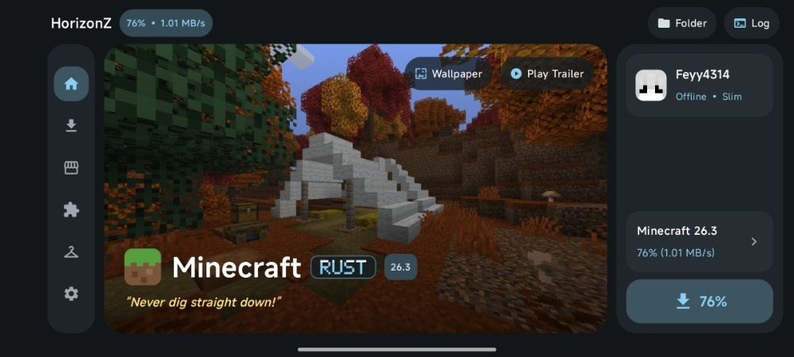
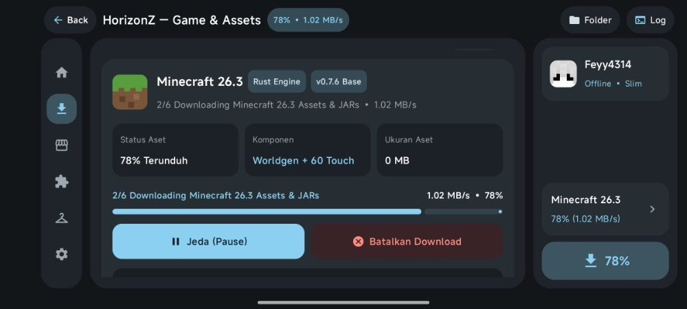
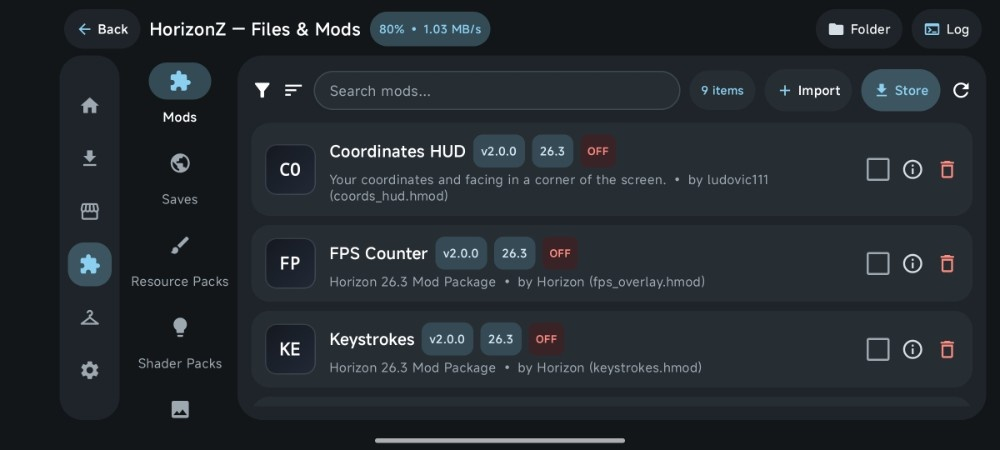
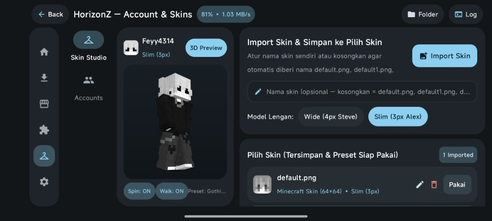
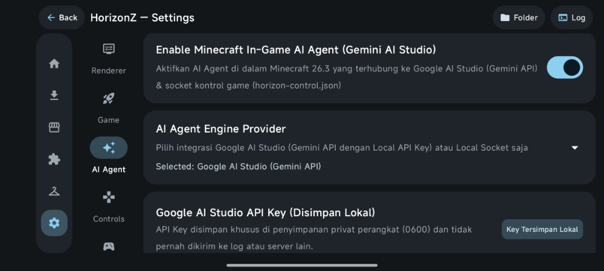

<!-- HORIZONZ_README_PRESERVE -->
<!-- HORIZONZ_README_MOBILE_V3 -->

# 🎮 HorizonZ Launcher Android

**Native Rust Minecraft 26.3 Launcher & Engine for Android (`arm64-v8a` & `armeabi-v7a`)**

<!-- VERSION_BADGE_START -->

<!-- VERSION_BADGE_END -->

<!-- LATEST_VERSION_START -->
> 🚀 **Latest Release — HorizonZ v1.8**: Full **Google AI Studio (Gemini API)** integration with **22+ model options** (`Gemini 4 Argon`, `Gemini 4.0 Ultra/Pro/Flash`, `Gemini 3.8 Pro/Flash`, `Gemini 3.5 Flash-Lite`, `Gemini 2.5 Pro/Flash`, `Gemma 3`), **Random Minecraft Cinematic & Official Trailer** player (< 5 minutes) on the Dashboard, full support for **WGSL Shader Packs (`horizon-shaders.toml` schema 1)**, and **Native Mods (`.hnmod` / `.hmod`)** synchronization.
<!-- LATEST_VERSION_END -->

## ✨ Key Features

- 🦀 **100% Native Rust Engine (`Minecraft 26.3`)**: Runs directly on **Vulkan** & **OpenGL ES (`wgpu`)** through `libhorizon_android.so` without *garbage collection* or Java VM overhead (`arm64-v8a` & `armeabi-v7a`).
- 🤖 **In-Game AI Agent (`Google AI Studio / Gemini API`)**: Connects to the game's local control protocol (`horizon-control.json`) with **22+ Gemini model options** (`Gemini 4 Argon`, `Gemini 3.8`, `Gemini 3.5 Flash-Lite`, `Gemini 2.5`, etc.) and **100% local on-device API Key storage (`0600`)**.
- 🎬 **Random Cinematic & Trailer Player**: Randomly plays a collection of **Minecraft Cinematic & Official Trailer** videos, each < 5 minutes long, in 720p quality, with captions automatically disabled and a minimalist 3-dot control menu.
- 🧩 **2-Way Store & Manager Synchronization**: Download, install, and update **Mods (`.hmod`)**, **Native Mods (`.hnmod`)**, **Shader Packs (`.hshader`)**, **Resource Packs**, and **Modpacks (`.hpack`)** directly from the `playhorizon.dev/mods` catalog.
- 🧠 **Dynamic RAM Allocation**: Configures the *engine* memory budget (`horizon-memory.txt` & `WGPU_MEMORY_BUDGET_MB`) according to the device's RAM capacity, with **Unlimited (OS Limit)** as the default mode.
- 🎨 **Interactive 3D Skin Studio**: 3D character preview (360° rotation & walking animation), automatic detection of **Wide (4px)** / **Slim (3px)** arms, and a library of ready-to-use skins.
- ⚡ **Zero-Overhead Gaming**: All background *threads*, UI *timers*, and the trailer `WebView` are automatically stopped when entering the `:game` process.

## ⚙️ Architecture & Technical Details

| Technical Component | Specifications & How It Works in HorizonZ |
| :--- | :--- |
| **Process & Rendering (`:game`)** | `HorizonActivity` runs in a separate process (`android:process=":game"`) using `NativeActivity` + `wgpu` (**Vulkan Compatibility**, **Vulkan High-Perf**, or **OpenGL ES**) with support for *Android ADPF thermal hints*. |
| **Assets & Worldgen System (`26.3`)** | Downloads and verifies SHA-1/SHA-256 for `client.jar`, Mojang CDN asset objects, the `26.3` *worldgen* registry, and 60 touch-control textures in `.local/horizon-client/26.3`. |
| **Mod Pipeline & WGSL Shaders** | Supports `.hmod` & `.hnmod` *mixin* compilation (`horizon-mods.txt` & `horizon-extras.txt`), as well as automatic `.hshader` validation (`horizon-shaders.toml` `schema = 1` for the `sky.wgsl` & `post.wgsl` *stages*). |
| **Gemini AI Agent Bridge** | The `HorizonZ-GeminiAgentBridge` daemon connects the `$HORIZON_CONTROL` JSON-line *socket* (`state`, `inventory`, `looking-at`, `messages`) to the `generativelanguage.googleapis.com` endpoint using the local key `horizon-gemini-secret.json` (`0600`). |
| **Auto-Sync Runtime (`BBS/`)** | The `BBS/sync_and_merge_bbs.py` module pulls *runtime* updates from `Vasysik/horizon-android` (`v0.7.6`) and automatically reapplies all HorizonZ Rust *patches* during the *build*. |

## 📱 Launcher Interface Screenshots

### 🏠 1. Main Dashboard (HD Wallpaper & Random Cinematic Trailer)

### ⬇️ 2. Game & Assets Manager (Download, Smart Repair & Asset Allocation)

### 🛒 3. HorizonZ Store (`playhorizon.dev/mods` Registry)

### 🧩 4. Files & Mods Manager (Mods, Saves, Resource Packs & Shaders)

### 👕 5. Account & 3D Skin Studio

### ✨ 6. Settings & AI Agent Integration (Google AI Studio / Gemini API)

## 📥 APK Download & Quick Start

### What's New in v1.8
- Expanded the in-app Gemini model picker with additional presets and manual model-ID entry.
- Added ordered Gemini API fallback attempts, trying the selected model ID before fallback endpoints.
- Randomized Dashboard cinematic/trailer playback and expanded the fallback trailer list.

| Component | Archive v1.2.0 value |
|---|---|
| Application ID | `dev.horizonr.mobile` |
| `versionName` / `versionCode` | `1.2.0-HorizonZ` / `52` |
| Minimum Android | API 28 (Android 9) |
| Compile / target SDK | API 35 / API 35 |
| APK ABIs | `arm64-v8a` and `armeabi-v7a` |
| Android UI | Kotlin 2.0.21, Jetpack Compose, Android Gradle Plugin 8.7.3 |
| Native layer | Rust `cdylib` + JNI; engine workspace prepared by CI |
| Release build tools | JDK 17, Android NDK 28.2.13676358, Gradle 8.10.2 |
| Graphics/device requirements | OpenGL ES 3.0 required; Vulkan 1 optional; touch screen and gamepad are optional in the manifest |
| Orientation | Launcher and game use landscape/sensor-landscape orientation |

## 📜 License & Credits

- 🔗 **Fork Repository**: [Fadiba21/HorizonZ-Launcher-Android](https://github.com/Fadiba21/HorizonZ-Launcher-Android)
- 📱 **Upstream Android Runtime**: [Vasysik/horizon-android](https://github.com/Vasysik/horizon-android) (`v0.7.6`)
- 🦀 **Core Rust Engine**: [horizon-rust/horizon](https://github.com/horizon-rust/horizon) (`Apache-2.0`)
