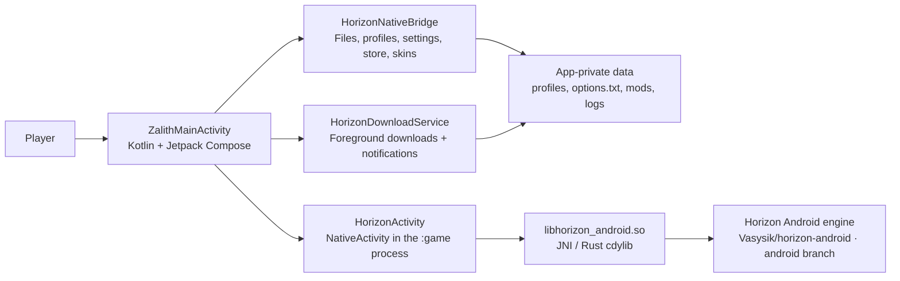

<!-- HORIZONZ_README_PRESERVE -->
<!-- HORIZONZ_README_LANGUAGE: en -->
<p align="center">
  
</p>

<h1 align="center">HorizonZ Launcher</h1>
<p align="center"><strong>Minecraft: Java Edition on Android — Kotlin launcher, native Rust runtime.</strong></p>
<p align="center">
  <a href="https://github.com/Fadiba21/Horizonz-Launcher/actions/workflows/build-apk.yml"></a>
  
  
</p>

<!-- HORIZONZ_VERSION_START -->
<p align="center">
  <a href="https://github.com/Fadiba21/Horizonz-Launcher/releases/latest"></a>
  <strong>Current source:</strong> <code>1.0.0-HorizonZ</code> · <strong>versionCode:</strong> <code>50</code> · <strong>Minimum Android:</strong> API 28 · <strong>Compile/target SDK:</strong> 35/35
</p>
<!-- HORIZONZ_VERSION_END -->

> **Banner and screenshots:** these images are included with the HorizonZ 1.0.0 source archive.

## 📘 Contents

- [About HorizonZ](#-about-horizonz)
- [Features](#-features)
- [Latest source update](#-latest-source-update)
- [How it works](#-how-it-works)
- [Technical specifications](#-technical-specifications)
- [Build and downloads](#-build-and-downloads)
- [Authentic launcher screenshots](#-authentic-launcher-screenshots)
- [Source map](#-source-map)
- [ZIP updates and README language](#-zip-updates-and-readme-language)
- [License and attribution](#-license-and-attribution)

## 🎮 About HorizonZ

HorizonZ is an Android launcher for **Minecraft: Java Edition**, powered by the native Horizon runtime. Archive v1.0.0 combines a Kotlin/Jetpack Compose Android interface with a Rust engine packaged as a JNI library. The app provides a dashboard, game-version and asset management, a content catalog, file access, accounts and skins, logs, and settings. The game runs in a separate Android process from the launcher.

This source targets Minecraft Java Edition 26.3. HorizonZ is a community project and **is not affiliated with Mojang or Microsoft**.

## ✨ Features

| Area | What Archive v1.0.0 contains |
|---|---|
| 🏠 **Home dashboard** | Wallpaper carousel, splash text, and user wallpaper import; CI can prepare up to 18 widescreen 1280 × 720 backgrounds. |
| ⬇️ **Game and assets** | First-run game and asset downloads with Android progress notifications, including live stage and transfer progress. |
| 🧩 **Store and mods** | Mods, Native Mods, Modpacks, Resource Packs, and Shader Packs; install/update state and per-folder content management. |
| 📁 **Files** | File access and import/export through Android's Storage Access Framework and the app's document provider. |
| 👤 **Accounts and skins** | Profile and skin management, including 64×64 and legacy 64×32 skin imports with wide/slim arm-model detection. |
| ⚙️ **Settings** | Renderer selection, resolution scaling, FPS, touch/gamepad controls, and synchronization of supported runtime options. |
| 🧾 **System logs** | Cross-process logs and log clearing, plus performance-report export and asset repair actions. |
| 🎮 **Gameplay** | Full-screen landscape `NativeActivity` in a separate `:game` process, touch controls, and a return to the launcher when the game exits. |

The main navigation includes **Home**, **Downloads**, **Store**, **Files & Mods**, **Account & Skins**, **System Logs**, and **Settings**.

## 🆕 Latest source update

<!-- HORIZONZ_UPDATE_SUMMARY_START -->
<!-- HORIZONZ_UPDATE_SUMMARY_LANGUAGE: en -->
**v1.0.0-HorizonZ — Archive source highlights.**

- **Native Android builds:** packages the Horizon Rust runtime with the Kotlin/Jetpack Compose launcher for `arm64-v8a` and `armeabi-v7a`.
- **Store and content management:** includes the Horizon mods catalog, file manager, profile/skin tools, and `.hmod` validation and repair paths.
- **First-run downloads:** prepares Minecraft 26.3 assets and Bedrock touch controls, with background download progress notifications.
- **Runtime integration:** syncs supported launcher settings with the game and runs gameplay in a separate Android process with clean-exit handling.
<!-- HORIZONZ_UPDATE_SUMMARY_END -->

## 🧱 How it works



Jetpack Compose renders the screens and handles navigation. `HorizonNativeBridge.kt` connects the UI to profiles, game files, the catalog, skins, logs, and the runtime. `HorizonDownloadService.kt` handles downloads as an Android foreground service. When the player taps **Play**, `HorizonActivity` launches `NativeActivity` in the separate `:game` process, loads `libhorizon_android.so`, prepares `HORIZON_HOME`, and starts the Rust runtime.

The engine workspace is not fully stored in this repository. The release workflow checks out the public [`Vasysik/horizon-android`](https://github.com/Vasysik/horizon-android) project on its `android` branch, applies HorizonZ patches, and builds the Android native library.

## ⚙️ Technical specifications

| Component | Archive v1.0.0 value |
|---|---|
| Application ID | `dev.horizonr.mobile` |
| `versionName` / `versionCode` | `1.0.0-HorizonZ` / `50` |
| Minimum Android | API 28 (Android 9) |
| Compile / target SDK | API 35 / API 35 |
| APK ABIs | `arm64-v8a` and `armeabi-v7a` |
| Android UI | Kotlin 2.0.21, Jetpack Compose, Android Gradle Plugin 8.7.3 |
| Native layer | Rust `cdylib` + JNI; engine workspace prepared by CI |
| Release build tools | JDK 17, Android NDK 28.2.13676358, Gradle 8.10.2 |
| Graphics/device requirements | OpenGL ES 3.0 required; Vulkan 1 optional; touch screen and gamepad are optional in the manifest |
| Orientation | Launcher and game use landscape/sensor-landscape orientation |

## 🛠️ Build and downloads

### Download an APK

Open [GitHub Releases](https://github.com/Fadiba21/Horizonz-Launcher/releases/latest) and choose the APK for the device architecture: `arm64-v8a` for most modern Android phones or `armeabi-v7a` for 32-bit devices. Releases include `SHA256SUMS.txt` for integrity checks.

### Build from source

The complete release build is defined in [`.github/workflows/build-apk.yml`](.github/workflows/build-apk.yml). It sets up JDK 17, Android platform/build-tools 35, the NDK, and Android Rust targets; fetches the engine workspace and applies patches; prepares control textures and wallpapers; builds both configured ABI variants; and publishes the APKs and checksums only after both ABI builds succeed.

`tools/android_build.py` is a helper for an already prepared workspace. For a release-equivalent build, use GitHub Actions because that workflow also prepares the engine checkout and patches. Example helper command after the required native workspace and dependencies are available:

```bash
python3 tools/android_build.py --abi arm64-v8a --profile release --public
```

## 📸 Authentic launcher screenshots

These launcher screenshots are included with the HorizonZ 1.0.0 source archive.

### 🏠 Home


### 🛍️ Store


### 🧩 Files and Mods


### 👤 Account and Skins


### ⚙️ Settings


## 🗂️ Source map

| Path | Purpose |
|---|---|
| `packaging/android/java/.../ui/` | Compose launcher screens and theme |
| `packaging/android/java/.../bridge/` | Kotlin bridges for files, profiles, downloads, store, skins, settings, and logs |
| `packaging/android/java/.../service/` | Foreground download service |
| `packaging/android/java/dev/horizon/android/HorizonActivity.java` | Game `NativeActivity`, runtime environment, splash, and exit watchdog |
| `crates/horizon-android/` | Rust JNI/cdylib Android library used by the build |
| `packaging/android/res/drawable-nodpi/` | Bundled pixel wallpapers and app assets |
| `docs/screenshots/` | Launcher banner, launcher screenshots, and in-game screenshots included in the source archive |
| `scripts/patch_horizon_direct_boot.py` | Patch applied to the engine workspace by CI |
| `scripts/prestage_controls_and_wallpapers.py` | Prepares touch-control textures and release wallpapers |
| `scripts/apply_update_zip.py` | Applies a source ZIP from `Update/` while protecting README layout/language |
| `tools/android_build.py` | Rust/Gradle build helper |
| `.github/workflows/build-apk.yml` | APK build and release pipeline |

## ♻️ ZIP updates and README language

This branch is based on **Archive v1.0.0-HorizonZ**. The input ZIP is intentionally not committed under `Update/`; only its source files are applied.

The README starts with `<!-- HORIZONZ_README_PRESERVE -->` and `<!-- HORIZONZ_README_LANGUAGE: en -->`. The ZIP updater preserves an existing README carrying the preserve marker and updates only supported version blocks when matching markers are present; it does not replace the README wholesale. This English summary and the release-specific feature details are maintained to match the applied source.

For a future source ZIP, preserve this README and update only the marked summary with accurate English notes about the changes. If the minimum Android version, SDKs, ABI, build tools, or runtime architecture changes, update the relevant technical sections as well.

## 📜 License and attribution

See [`LICENSE.txt`](LICENSE.txt) and [`THIRD_PARTY_NOTICES.md`](THIRD_PARTY_NOTICES.md) for source and third-party component licensing. Minecraft is a trademark of Mojang/Microsoft; HorizonZ is not an official Mojang or Microsoft product.
